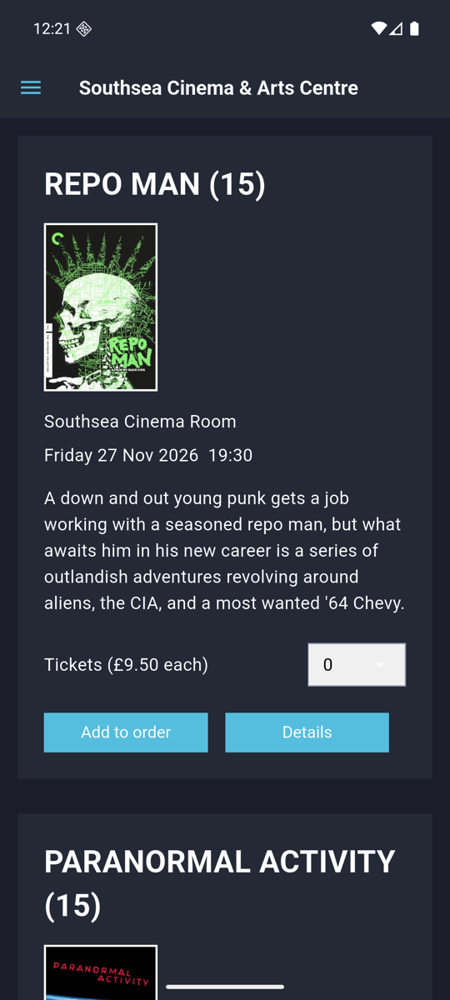
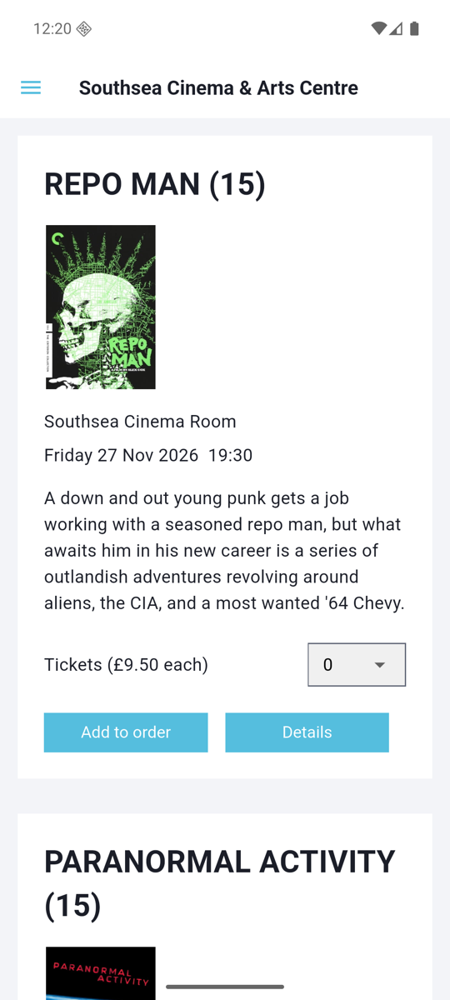
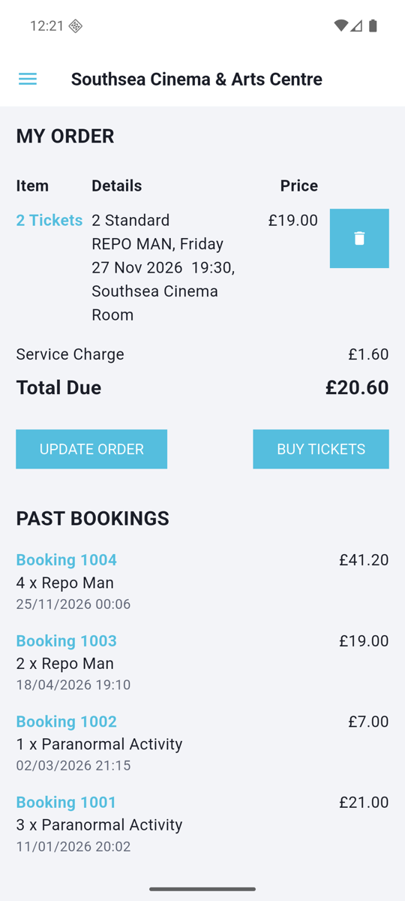
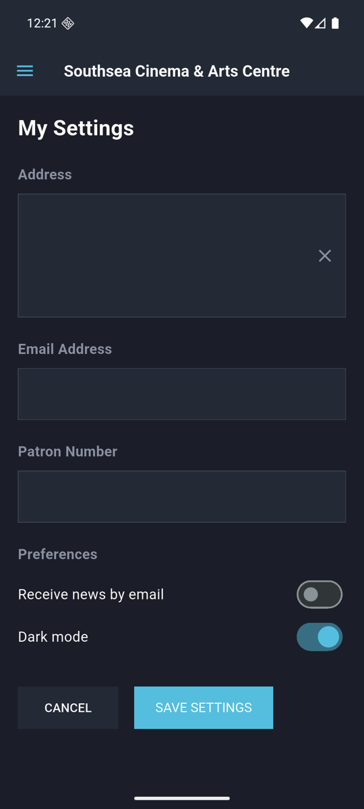

# Southsea Cinema

A Flutter app for browsing the films showing at Southsea Cinema, booking
tickets, and saving completed bookings. It is a mobile-friendly version of the
Southsea Cinema website:
<https://southseacinema.savoysystems.co.uk/SouthseaCinema.dll/>. The app is set
up for Android only.

## Features

- Browse the films on show, loaded from a bundled JSON file, and open a details
  page for each film.
- Choose a number of tickets and add them to the basket.
- Review the basket with its service charge and total, remove films, and buy
  tickets.
- Each purchase is saved as a numbered booking, and past bookings are listed
  below the basket. Bookings are stored locally in SQLite; the basket is held in
  memory.
- Fill in profile details and preferences on the settings page, including a dark
  mode switch. The light or dark choice is saved on the device with
  `shared_preferences`.

## Platform

The app runs on Android only, because it saves bookings in a SQLite database
file on the device. Use an Android emulator or a physical Android device.
Running it in a browser or on a desktop is not supported.

## Getting started

### Prerequisites

- [Flutter](https://docs.flutter.dev/get-started/install) with the Android
  toolchain set up.
- An Android emulator or device.
- Git.

### Clone

```bash
git clone https://github.com/aGreyArea/southsea_cinema.git
cd southsea_cinema
```

### Install dependencies

```bash
flutter pub get
```

### Run

Start an Android emulator or connect a device, then run:

```bash
flutter run
```

## Tests

Run the automated unit and widget tests with:

```bash
flutter test
```

These tests use an in-memory SQLite database and in-memory preferences, so they
do not require an Android emulator. Running the app itself does require an
Android emulator or device.

To measure test coverage, run `flutter test --coverage`. The report is written
to `coverage/lcov.info`.

## Project structure

- `lib/models/` holds the data classes, such as `Movie`, `CartItem`, `Booking`
  and `UserSettings`.
- `lib/repositories/` holds the films, the in-memory basket, the settings and
  the saved theme choice.
- `lib/database/` holds the SQLite database for saved bookings.
- `lib/views/` holds the home, film details, basket and settings screens.
- `lib/widgets/` holds the reusable button, the film card and the navigation
  drawer.
- `lib/theme.dart` holds the light and dark themes.
- `assets/data/` holds the film list, and `assets/images/` holds the film
  posters.
- `test/` mirrors the folders in `lib/`.

## Screenshots

### Home

The home page lists the films currently showing, with their screening times,
prices and a ticket picker. It is shown here in dark mode and light mode.





### Basket

The user can add tickets to their basket and buy them. Past bookings appear
below the basket, with the highest booking number first.



### Settings

The settings page holds the user's profile details and preferences, including
the dark mode switch.


